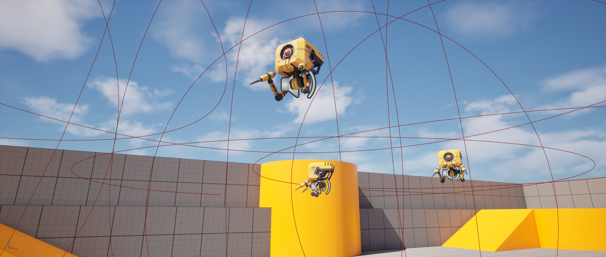
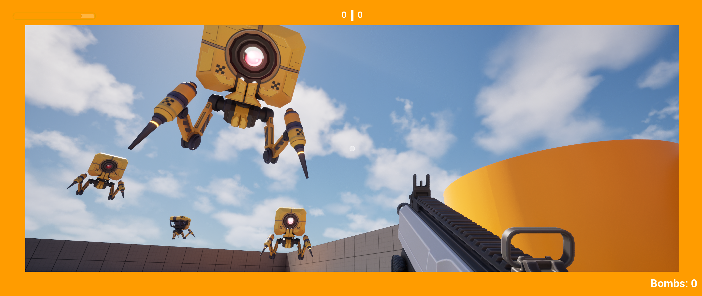
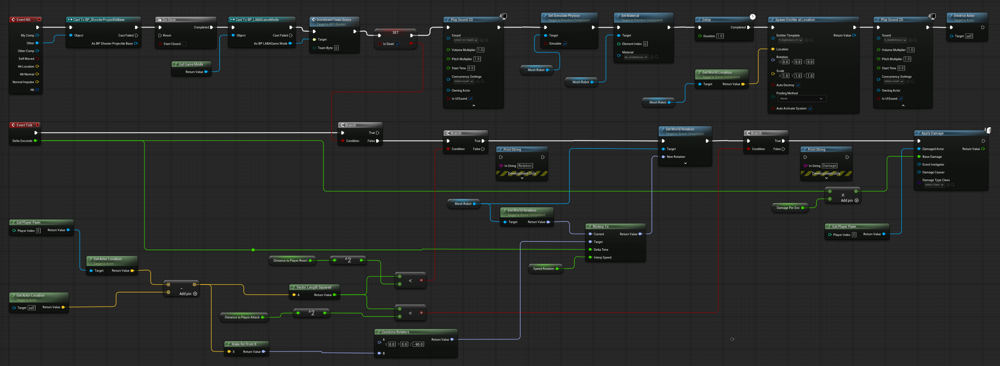
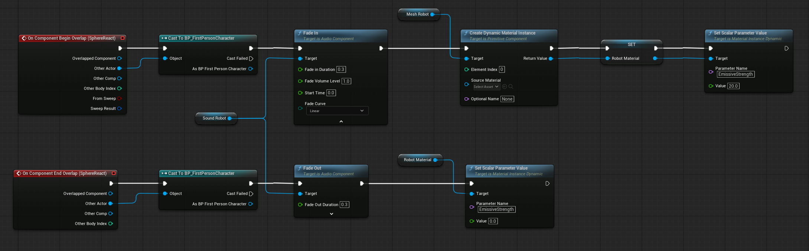

# Robot Shooting Targets — Unreal Engine

A robot shooting target system created in Unreal Engine as part of the **LABA IT — Unreal Engine — C++** course. This repository showcases the project through a demonstration video, scene screenshots, and its Blueprint logic.

## Demo Video

[▶ Watch the demo on YouTube](https://www.youtube.com/watch?v=ifBxlt9JkFQ)

The video demonstrates robot targets tracking the player, proximity damage, glowing eyes and sound activated by player detection, robot destruction, and a moving platform.

## Features

- Robot meshes replacing basic cube targets.
- Smooth horizontal and vertical player tracking using `RInterp To`.
- Player direction and distance calculated on `Event Tick` as an exercise in vector math.
- Customizable tracking and attack distances, demonstrated at 800 and 500 Unreal units.
- Configurable rotation interpolation speed and damage per second.
- Continuous proximity damage scaled by `Delta Seconds`.
- Sphere overlap events activating the robot's glowing eye and audio.
- Audio fade-in and fade-out when entering or leaving the detection sphere.
- Dynamic material control through the `EmissiveStrength` parameter.
- Projectile hit detection and team scoring, with `Do Once` preventing repeated scoring.
- Tracking and damage disabled when the robot is destroyed.
- Physics-enabled collapse, a material change, and delayed explosion effects with sound.
- Automatic removal of the robot after the explosion.
- A platform that moves along the X or Y axis.

## Scene Preview

## Blueprints

### BP_ShootingTarget_Robot — Tracking, Damage, and Destruction

On `Event Tick`, the Blueprint subtracts the robot's position from the player's position to calculate a direction vector. `Vector Length Squared` is compared against squared tracking and attack distances. These checks are retained as an exercise in vector math, while the distance thresholds remain customizable.

Within tracking range, `Make Rot from X` and `Combine Rotators` calculate the desired orientation, including an offset for the imported mesh. `RInterp To` interpolates from the mesh's current world rotation towards this orientation, and `Set World Rotation` applies the result. Within attack range, `Apply Damage` uses `Damage Per Sec` multiplied by `Delta Seconds`.

`Event Hit` checks for a `BP_ShooterProjectileBase` projectile. A valid hit passes through `Do Once`, increments the team score through GameMode, and sets `Is Dead`. This stops tracking and damage. The robot plays a hit sound, enables physics simulation, and changes material. After a one-second delay, an explosion effect is spawned at the mesh's current world location, a destruction sound plays, and the actor is destroyed.

[View the full-resolution Blueprint](screenshots/bp-robot-target.png)

### BP_ShootingTarget_Robot — Proximity Audio and Glowing Eye

When a `BP_FirstPersonCharacter` enters `SphereReact`, the robot's audio fades in over 0.3 seconds. The Blueprint creates a dynamic material instance for the robot mesh, stores it in `RobotMaterial`, and sets `EmissiveStrength` to 20 to activate the eye glow.

When the player leaves the sphere, the audio fades out over 0.3 seconds and `EmissiveStrength` is set to 0 on the stored material instance. Sphere overlaps control audio and visual feedback; the vector-based distance checks on Tick control tracking and damage.

[View the full-resolution Blueprint](screenshots/bp-robot-audio-glow.png)

## Asset Credits

Robot model: **Mech Drone** by **Willy Decarpentrie (skudgee)**, available on [Sketchfab](https://sketchfab.com/3d-models/mech-drone-8d06874aac5246c59edb4adbe3606e0e), under **Creative Commons Attribution (CC BY)**. The model was integrated into the robot target Blueprint with custom gameplay behavior.

## Repository Contents

This repository contains visual documentation and a link to the demo video. It does not include a `.uproject` file, `.uasset` files, or C++ source code, so it cannot be opened as an Unreal Engine project. The moving platform is demonstrated in the video; its Blueprint is not included here.
